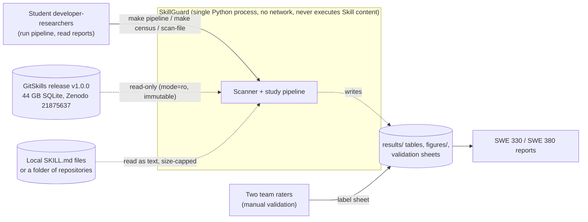
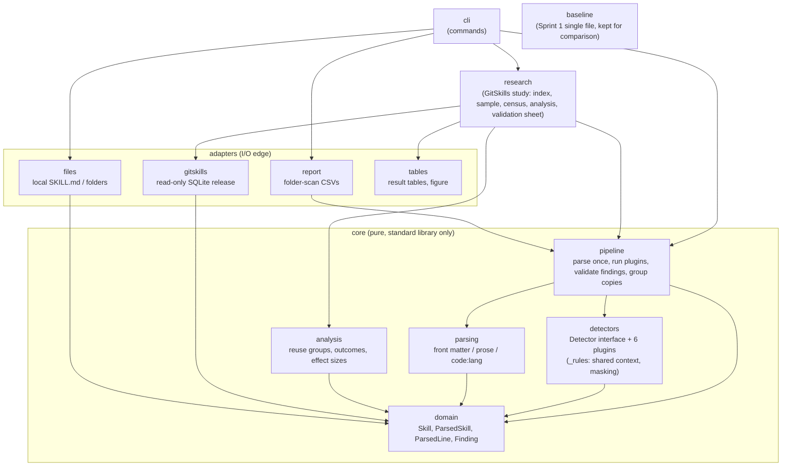
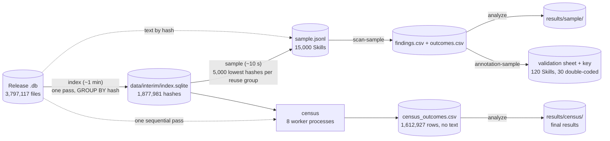
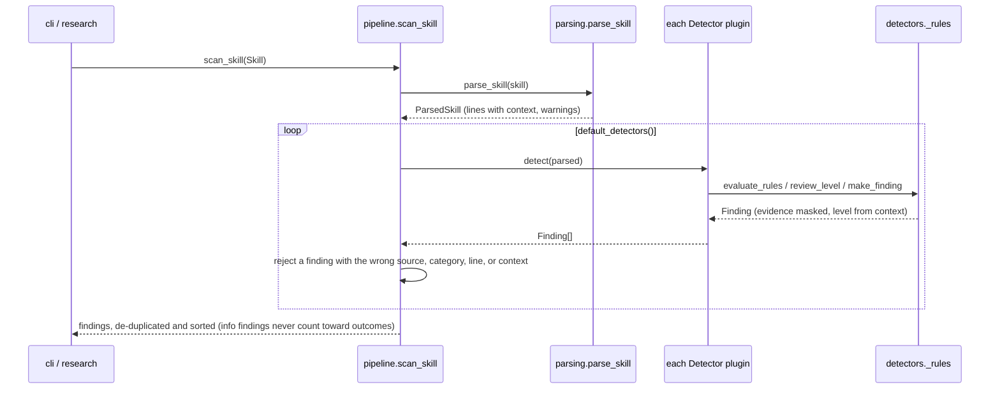

# SkillGuard Architecture (final, Phase 3)

**Course:** SWE 330 Phase 3 (issue #26) · **Status:** Final design as of 2026-11-16 · What changed since Phase 2 and why: [`changes-since-phase2.md`](changes-since-phase2.md) · Phase 2 views: [`phase2-views.md`](phase2-views.md)

SkillGuard is a **modular monolith with ports-and-adapters boundaries**: one Python process whose core (parse → detect → validate findings) never reads files or the database, surrounded by adapters for local files, the GitSkills release, and reports. Detection is a set of **plugins**, one per capability category, behind one `Detector` interface. The four views below use one notation (Mermaid; solid arrows = "depends on" or "calls", dashed = "reads/writes data"). Decisions behind them are in [`docs/decisions/`](../decisions/). A code reading guide is in [`zaid-reading-guide.md`](zaid-reading-guide.md).

## View 1: System context

*Purpose: show the boundary.* SkillGuard has no network access and no way to execute Skill content; everything outside the box is data.

## View 2: Modules and dependency direction

*Purpose: show the central design decision.* Dependencies point inward to `domain`. The core (`domain`, `parsing`, `detectors`, `pipeline`, `analysis`) imports no I/O modules, and detectors see only parsed records. Two tests fail the build on any arrow not drawn here: `tests/unit/test_architecture.py` and `tests/unit/test_layer_boundaries.py` (0 violations).

**Extension point.** A new capability category is one module with a `Detector` subclass (`category` and `detect(parsed)`) plus one entry in `detectors/__init__.py: default_detectors()`. Pipeline, outcomes, tables, and the figure pick up new categories from the registry without edits (ADR-0010).

## View 3: Pipeline data flow

*Purpose: show persistence and reproducibility.* Each step reads the previous step's file, so steps can be re-run separately, and every output is deterministic.

## View 4: Scanning one Skill (sequence)

*Purpose: show where explanation and safety are enforced.* Text is parsed once, every plugin sees the same parsed lines, and the pipeline checks every finding before accepting it.

## Quality attributes and the evidence for them

| Quality (GQM) | Mechanism | Final evidence |
|---|---|---|
| Extensibility (Q1) | Plugin interface + registry; shared rule engine | Four real detector additions (#38): after the first, each touched 2 files and 0 core modules |
| Change isolation (Q2) | Inward dependencies, two conformance tests, finding validation in the pipeline | 0 dependency violations; 100% of existing tests passed after each addition |
| Reproducibility (Q3) | Deterministic sample, sorted outputs, fixed precision, `make pipeline` / `make census` | Byte-identical outputs across runs; setup in a fresh Python 3.15 environment |
| Performance (Q4) | One-pass index; parallel census | `results/evaluation/benchmark.csv`; census run time in the final report |
| Explainability and testability (Q5) | `Finding` validated when created and again in the pipeline; tests per rule | 100% field completeness; coverage in the final report |
