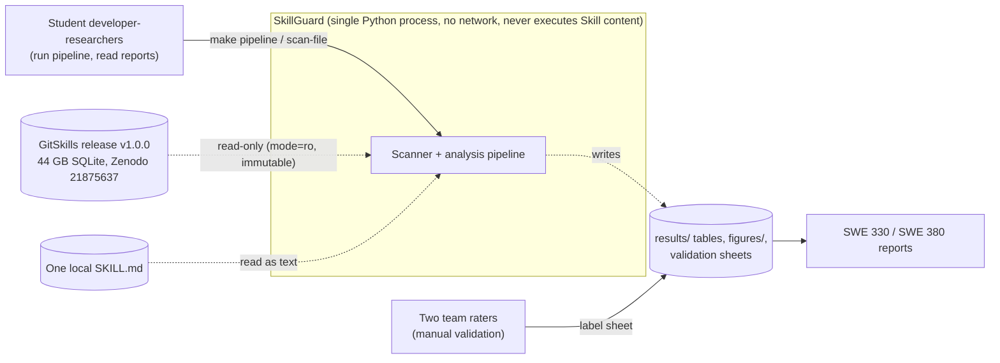
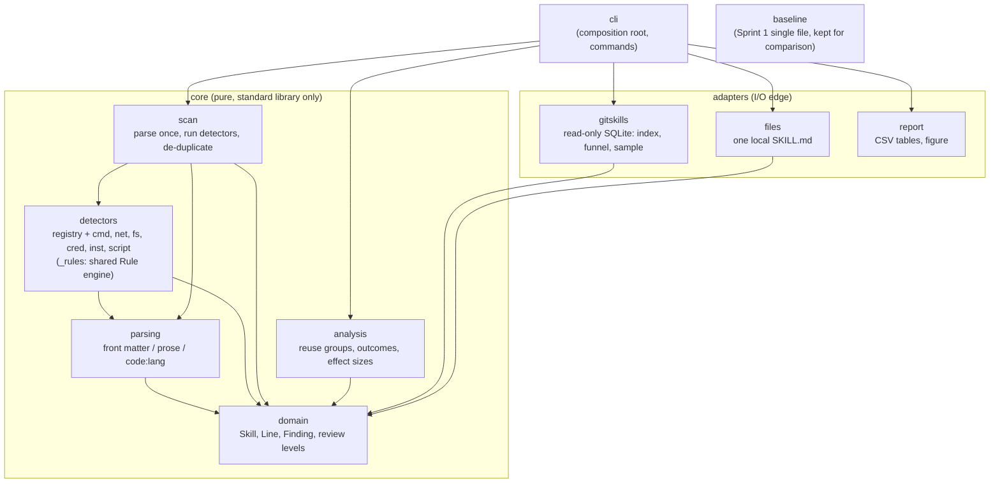
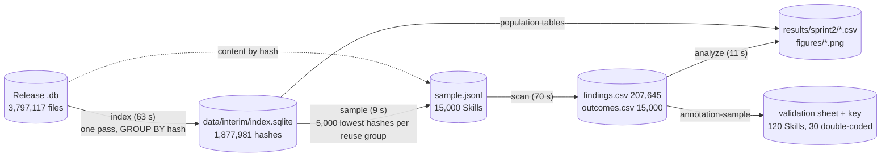
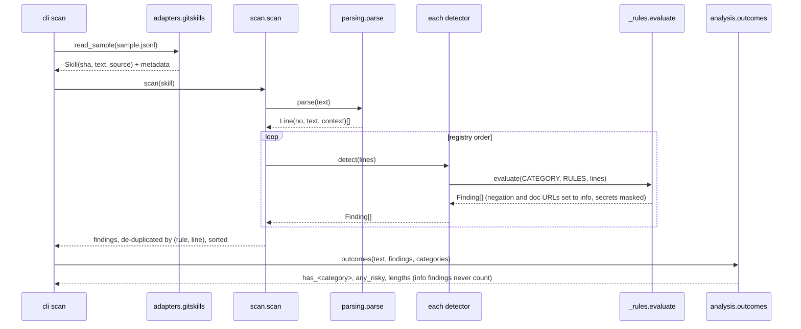

# SkillGuard Architecture (Phase 2)

**Course:** SWE 330 Phase 2 (issue #14) · **Status:** Proposed for team review · **Code:** branch `issue-15-modular-skillguard`

SkillGuard is a **modular monolith with ports-and-adapters boundaries**: one Python process whose pure core (parse → detect → explain) never performs I/O, surrounded by adapters that read the GitSkills release or a local file and write tables and figures. The four views below use one notation (Mermaid flowcharts and a sequence diagram; solid arrows = "depends on" or "calls", dashed = "reads/writes data"). Decisions behind them are in [`docs/decisions/`](../decisions/).

## View 1: System context

*Purpose: show the boundary.* SkillGuard has no network access and no execution path for Skill content; everything outside the box is data.

## View 2: Modules and dependency direction

*Purpose: show the central design decision.* Dependencies point inward to `domain`. The core (`domain`, `parsing`, `detectors`, `scan`, `analysis`) imports no I/O modules; detectors see only parsed lines. `tests/unit/test_architecture.py` fails the build on any arrow not drawn here (0 violations on 2026-10-26).

The extension point is the detector registry (`detectors/__init__.py`): a new category is one module exposing `CATEGORY` and `detect(lines)`, plus one registry entry (ADR-0003). Analysis, outputs, and the figure pick up new categories from the registry without code changes.

## View 3: Pipeline data flow

*Purpose: show persistence and reproducibility.* Each step reads the previous step's file, so steps can be re-run independently, and every output is deterministic (two full runs produced byte-identical files).

## View 4: Scanning one Skill (sequence)

*Purpose: show where explanation and safety are enforced.* Text is parsed once; every finding carries category, rule ID, line, masked evidence, explanation, review level, and context.

## Quality attributes and where they live

| Quality (GQM) | Mechanism | Evidence (Phase 2) |
|---|---|---|
| Extensibility (Q1) | Detector registry; detectors are declarative `Rule` lists | Adding PRIV in a pilot: 0 core modules modified, 2 edit sites (vs 4 in the baseline) |
| Change isolation (Q2) | Inward dependencies, conformance test | 0 violations; adding PRIV changed no other category's findings on 3,000 Skills |
| Reproducibility (Q3) | Deterministic sample (hash order), sorted CSVs, fixed float precision, `make pipeline` | 10 of 10 artifacts byte-identical across two full runs |
| Performance (Q4) | Single pass index in SQLite; streaming scan | Same rules: 1.55× the baseline's runtime; all 23 rules: 228 Skills/s, 133 MB peak |
| Explainability and testability (Q5) | `Finding` record; one positive + one negative test per rule | 100% field completeness; 100% detector/parsing coverage |
