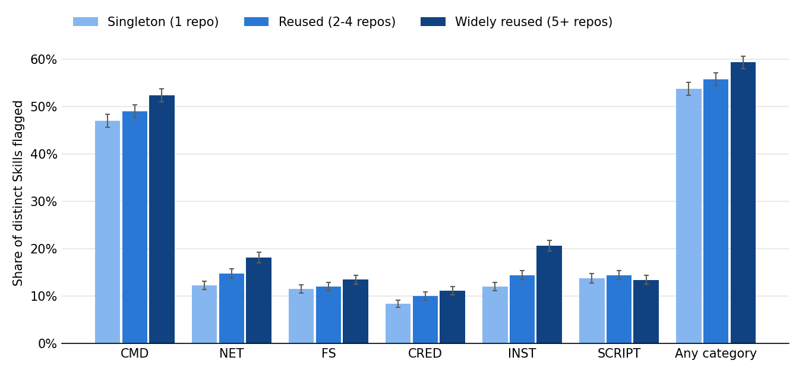

# SkillGuard: Are Widely Reused Agent Skills More Likely to Carry Potentially Risky Capabilities?

**SWE 380 research report — Sprint 2 draft (2026-10-26).** Results are **preliminary**: the detector has not yet been manually validated (Section 6). Every number comes from files generated by `make pipeline` (code branch `issue-15-modular-skillguard`).

## Abstract

AI-agent Skills are instruction files (`SKILL.md`) that agents follow with their user's permissions, and half of all Skill files on GitHub are copies. We ask whether widely reused Skills more often contain potentially risky capability signals (commands, network access, file changes, credential handling, installs, script execution). Using the GitSkills release (1,612,927 distinct Skills after filtering) and a stratified sample of 15,000, an explainable rule-based scanner flags at least one category in 53.8% of singleton Skills and 59.3% of Skills found in 5 or more repositories (odds ratio 1.26, 95% CI 1.16–1.36). Widely reused Skills are also longer, and adjusting for length removes the overall difference (adjusted OR 1.01, 0.93–1.10). Two categories stay elevated after adjustment: dependency installation (adjusted OR 1.53, 1.37–1.72) and network access (1.21, 1.07–1.36). These preliminary findings depend on detector accuracy, which the team will measure next.

## 1. Introduction

A Skill is a folder with a `SKILL.md` file that an agent loads when a task matches its description. Skills can tell the agent to run commands, call web APIs, edit files, read secrets, install packages, or run bundled scripts. When a Skill is copied, these capabilities travel with it, and the person adopting it may not notice them. If widely copied Skills carry more of these capabilities, review effort should focus on them.

**Contributions so far:** (1) SkillGuard, an explainable scanner with 23 tested rules in 6 categories; (2) a population profile of reuse in GitSkills; (3) preliminary prevalence comparisons with a length baseline; (4) a validation protocol and blind sheet.

## 2. Research question and expectations

**RQ1.** Are widely reused GitSkills more likely than non-reused GitSkills to contain potentially risky capabilities?

We set no directional hypothesis. The main competing explanation is **length**: longer Skills give rules more chances to match, and reused Skills may be longer or more automation-focused. Definitions and non-claims are in `RESEARCH_QUESTION.md`.

## 3. Dataset and preparation

GitSkills v1.0.0 (Zenodo record 21875637, CC-BY-4.0) is a 44 GB SQLite file with 3,797,117 `SKILL.md` files from 282,200 repositories, collected in July 2026. Files are grouped by content hash into 1,877,981 distinct contents; text is stored once per hash. We verified the schema, row counts, and MD5 (`DATA_DICTIONARY.md`).

**Unit of analysis:** one distinct content (`file_sha`). **Exposure:** `repository_count`, the number of repositories holding a copy named exactly `SKILL.md`; groups are singleton (1), reused (2–4), and widely reused (5 or more).

**Population filter** (`results/sprint2/population_funnel.csv`): exact `SKILL.md` name (−33,204), stored text matching its hash (−41), valid front matter (−231,809), leaving **1,612,927** Skills.

**Table 1. Population by reuse group** (`reuse_groups_population.csv`)

| Group | Distinct Skills | Share | File copies | Median body length (chars) | With scripts |
|---|---|---|---|---|---|
| Singleton | 1,355,955 | 84.1% | 1,478,253 | 4,790 | 11.9% |
| Reused (2–4) | 199,169 | 12.3% | 632,776 | 5,505 | 11.2% |
| Widely reused (5+) | 57,803 | 3.6% | 1,274,046 | 6,352 | 16.2% |

*Observation:* widely reused Skills are 3.6% of distinct contents but 37.6% of file copies, and their median length is 33% higher than singletons'.

**Sample:** the 5,000 lowest hashes in each group (15,000 Skills). Git blob hashes are uniform over contents, so this works like a simple random sample within each group. Estimates are per group, not population-weighted.

## 4. Method and implementation

SkillGuard parses each Skill into front matter, prose, and code blocks (with language), then applies 23 regular-expression rules in six categories (`THREAT_MODEL.md`): CMD (4 rules), NET (4), FS (5), CRED (4), INST (4), SCRIPT (2). Each finding records category, rule ID, line, masked evidence, explanation, review level, and context. Documentation-only URLs and negated prose ("never run …") are recorded at **info** level and never count. A Skill is flagged in a category if it has at least one review- or high-level finding there. The seventh category (PRIV, destructive or privileged operations) is held out for the SWE 330 extensibility experiment.

**Analysis:** prevalence per category and group with Wilson 95% intervals; risk differences and odds ratios vs singletons; logistic regression of each outcome on reuse group plus log(1 + lines) to adjust for length; a length-only baseline (AUC of length for predicting a flag); and sensitivity to the widely-reused threshold (3, 5, 10 repositories).

**Implementation:** a modular Python package (ports and adapters; architecture in `docs/architecture/`), 56 automated tests (every rule has a positive and a negative case; the pipeline runs on a synthetic release), and a one-command pipeline that reads the release without modifying it and takes about 2.5 minutes. Two full runs gave byte-identical outputs.

## 5. Preliminary results

**Figure 1.** Share of distinct Skills flagged per category and reuse group (95% Wilson intervals; n = 5,000 per group).



**Table 2. Widely reused vs singleton** (`comparisons.csv`; odds ratios with 95% CIs)

| Outcome | Singleton | Widely reused | Odds ratio | Length-adjusted OR |
|---|---|---|---|---|
| Any category | 53.8% | 59.3% | 1.26 (1.16–1.36) | 1.01 (0.93–1.10) |
| CMD | 47.0% | 52.4% | 1.24 (1.15–1.34) | 1.03 (0.95–1.12) |
| NET | 12.2% | 18.1% | 1.59 (1.42–1.77) | **1.21 (1.07–1.36)** |
| FS | 11.5% | 13.5% | 1.19 (1.06–1.35) | 0.87 (0.77–0.99) |
| CRED | 8.3% | 11.2% | 1.38 (1.21–1.58) | 1.06 (0.92–1.21) |
| INST | 12.0% | 20.6% | 1.91 (1.71–2.13) | **1.53 (1.37–1.72)** |
| SCRIPT | 13.7% | 13.4% | 0.97 (0.87–1.09) | 0.83 (0.73–0.93) |

The reused (2–4) group sits between the two for most categories (any category: 55.7%; OR 1.08, 1.00–1.17; adjusted 0.94, 0.87–1.02).

**Length baseline** (`length_baseline.csv`): length alone separates flagged from unflagged Skills with AUC 0.66 (0.61–0.72 by category). By length quartile, the share flagged rises from 34.9% to 55.7%, 62.1%, and 72.7%.

**Threshold sensitivity** (`sensitivity_threshold.csv`): the unadjusted odds ratio for any category is similar at 3+ repositories (1.21, 1.12–1.30), 5+ (1.26, 1.16–1.36), and 10+ (1.22, 1.10–1.35). Median length grows with the threshold (117 lines for singletons; 180, 185, and 205 lines).

**Rule activity** (`rule_counts.csv`): `CMD-001` (a line in a shell code block) accounts for 120,232 of 207,645 findings and flags 5,541 Skills. 14,767 prose URLs were recorded at info level and excluded. 49 sampled Skills contain strings matching hard-coded secret formats (81 findings, masked); these are unverified.

## 6. Discussion (preliminary)

**Observed:** widely reused Skills are flagged more often, by 5.6 percentage points (95% CI 3.6–7.5) for any category. They are also longer, and longer Skills are flagged more often in every category.

**Interpretation:** for the overall outcome, the competing explanation fits: once length is held constant, reuse adds nothing detectable. The exceptions are installs and network access, whose odds stay about 1.5 and 1.2 times as high in widely reused Skills. One possible reading is that widely copied Skills more often set up tools or call services; we have not tested this. File changes and script execution have slightly *lower* odds after adjustment.

**Not supported:** that reuse causes capabilities, that flagged Skills are unsafe, or that these rates hold for the true capabilities. The flags are rule matches whose precision and recall are unknown. `CMD-001` is broad and dominates the CMD and "any" outcomes.

## 7. Validation plan (Sprint 2 protocol, Sprint 3 execution)

A blind sheet of 120 Skills (60 flagged, 60 not; spread across reuse groups; 30 double-coded) and an annotation guide are ready (`docs/validation/ANNOTATION_GUIDE.md`). Two members label independently; Cohen's kappa is computed on the shared items; disagreements are resolved and recorded; precision, recall, and F1 are computed per category by `scripts/score_validation.py`.

## 8. Threats to validity (summary)

Construct: rule matches are not verified capabilities, and exact hashes undercount reuse. Internal: length and Skill purpose confound reuse; only length is adjusted so far. External: public GitHub only, one July 2026 snapshot. Conclusion: 7 outcomes × 2 contrasts × 3 thresholds, so intervals should be read with multiplicity in mind. Reproducibility: deterministic pipeline; clean-setup trial pending. Details: `THREATS_TO_VALIDITY.md`.

## 9. Related work (to be expanded in Sprint 3)

The GitSkills dataset and its description are the main source for the Skill format and collection method (Zenodo record 21875637). Rule-based static analysers for code (for example Bandit, ShellCheck, and Semgrep) inspired the explainable rule-and-evidence design; SkillGuard applies the idea to natural-language instruction files. Agreement is measured with Cohen's kappa (Cohen, 1960).

## 10. Next steps

Run the manual validation; tune rules only afterwards; re-run the analysis on validated rules; add the PRIV category through the timed extensibility experiment; consider repository characteristics (stars, forks) as further confounders.

## Artifact appendix

```bash
make setup
make test
make pipeline DB=/path/to/agent_skills_release.db
```

Outputs: `results/sprint2/*.csv`, `figures/sprint2_prevalence_by_reuse.png`, `data/annotations/sprint2_validation_{sheet,key}.csv`. Dataset: Zenodo record 21875637 (MD5 `b058631fb1926efac6e82a4706646742`).

## References

- GitSkills: A Dataset of Agent Skills on GitHub, v1.0.0. Zenodo record 21875637, 2026. https://zenodo.org/records/21875637
- J. Cohen. "A Coefficient of Agreement for Nominal Scales." *Educational and Psychological Measurement* 20(1), 1960.
- V. R. Basili, G. Caldiera, H. D. Rombach. "The Goal Question Metric Approach." *Encyclopedia of Software Engineering*, 1994.
