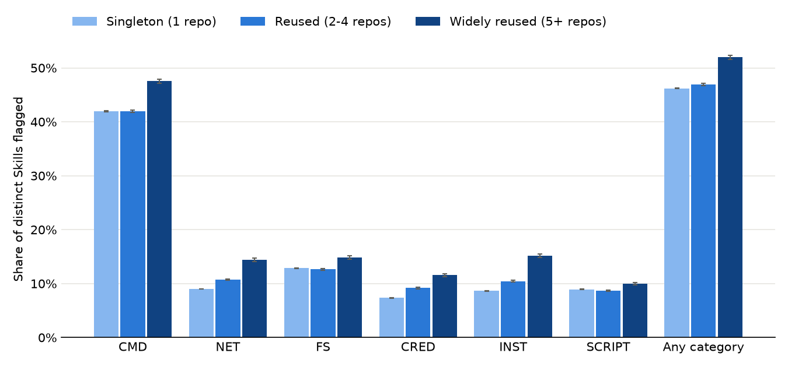

# SkillGuard: Are Widely Reused Agent Skills More Likely to Carry Potentially Risky Capabilities?

**SWE 380 final report draft (Sprint 3, November 2026)** · Team: Ibrahimatatri, Baiselaired, ixmecrash, skyr-csc · Repository: https://github.com/Ibrahimatatri/SWE-330-and-380

Every number comes from files generated by `make pipeline` or `make census` and is cited by file name. Results describe detector *signals*. Their precision and recall come from the manual validation of 120 Skills (Section 6). One reviewer has labelled all 120; a second reviewer for the 30 shared items is still needed.

## Abstract

AI-agent Skills are instruction files (`SKILL.md`) that agents follow with their user's permissions, and half of all Skill files on GitHub are copies of another file. We asked whether Skills copied into many repositories more often contain potentially risky capability signals: commands, network access, file changes, credential handling, software installation, and script execution.

We scanned all 1,612,927 valid Skills in the GitSkills release with an explainable rule-based scanner (six detector plugins, 18 rules). Skills found in five or more repositories were flagged in at least one category more often than Skills found in only one (52.0% vs 46.2%; odds ratio 1.26, 95% CI 1.24–1.28). Widely reused Skills are also longer, and once length is controlled the overall difference almost disappears (adjusted OR 1.02, 1.01–1.04).

Three categories stay clearly elevated after adjustment:
- software installation (adjusted OR 1.53, 1.50–1.57);
- network access (1.34, 1.31–1.37);
- credential handling (1.29, 1.25–1.32).

A manual review of 120 Skills found that SkillGuard's flags are usually right (precision 0.71–1.00 by category) but that it misses many capabilities (recall 0.23–0.71), so the census rates are lower bounds.

Reuse is therefore not a general marker of riskier Skills, but widely copied Skills more often ask agents to install software, call online services, and handle credentials. Reviewers of copied Skills may want to look at exactly those.

## 1. Introduction

A Skill is a folder with a `SKILL.md` file that an agent loads when a task matches its description. Its instructions can tell the agent to run shell commands, fetch URLs, edit files, read secrets, install packages, or run bundled scripts. When a Skill is copied between repositories, these capabilities travel with it, and the person adopting it may not read every line. If widely copied Skills carry more capabilities, review effort should concentrate on them.

**Contributions:**
1. SkillGuard, an explainable static scanner for `SKILL.md` files. It never executes content, and every finding has a rule, a line, masked evidence, and a reason.
2. A whole-population profile of reuse in GitSkills.
3. Prevalence comparisons across reuse levels with a length baseline, robustness checks, and subgroups.
4. An error analysis and a manual validation of 120 Skills, with precision and recall per category.

## 2. Research question and expectations

**RQ1.** Are widely reused GitSkills more likely than non-reused GitSkills to contain potentially risky capabilities such as command execution, network access, file operations, credential access, dependency installation, or bundled-script execution?

We set no direction in advance. Copied "automation" Skills might carry more commands, or popular Skills might be more generic. The main competing explanation is **length**: longer Skills give rules more chances to match, and reused Skills may simply be longer or more automation-focused. Definitions, variables, and the claims we will not make are in `RESEARCH_QUESTION.md`.

## 3. Dataset and preparation

**Source.** GitSkills v1.0.0 (MSR 2027 Mining Challenge; Zenodo record 21875637; CC-BY-4.0) is a 44 GB SQLite file with 3,797,117 `SKILL.md` files from 282,200 public repositories, collected in July 2026. Files are grouped into 1,877,981 distinct contents by Git blob hash (`file_sha`). We verified the schema, row counts, and MD5 checksum (`DATA_DICTIONARY.md`).

**Unit and exposure.** The unit is one distinct content. Reuse is measured by `repository_count`, the number of repositories holding a copy named exactly `SKILL.md`. Groups: singleton (1), reused (2–4), widely reused (5 or more).

**Population filter** (`results/census/population_funnel.csv`):
- at least one copy named exactly `SKILL.md` (−33,204);
- stored text matching its hash (−41);
- valid YAML front matter (−231,809).

That leaves **1,612,927** Skills. The release stores identical text on two rows for 2,042 of them; the pipeline reads each hash once.

**Table 1. Population by reuse group** (`results/census/reuse_groups_population.csv`)

| Group | Skills | Share | File copies | Median length (characters) | Folder ships scripts |
|---|---|---|---|---|---|
| Singleton | 1,355,955 | 84.1% | 1,478,253 | 4,790 | 11.9% |
| Reused (2–4) | 199,169 | 12.3% | 632,776 | 5,505 | 11.2% |
| Widely reused (5+) | 57,803 | 3.6% | 1,274,046 | 6,352 | 16.2% |

*Observation:* widely reused Skills are 3.6% of distinct contents but 37.6% of all copies, and their median length is 33% higher than singletons'.

## 4. Method and implementation

**Detection.** SkillGuard parses each Skill once into front matter, prose, and code blocks (with their language), then runs six detector plugins (18 rules; `THREAT_MODEL.md`):

| Category | Rules | Example matches |
|---|---|---|
| Commands (CMD) | 4 | Shell code blocks, `$` prompts, "run `x`" |
| Network (NET) | 2 | HTTP clients; URLs with a fetch action or inside shell code |
| File changes (FS) | 4 | `cat`, `cp`, `rm`, write APIs, home and system paths |
| Credentials (CRED) | 3 | `.env` and key files, secret environment variables, "use/read/send a token" |
| Installs (INST) | 3 | Package managers, `npx`, `curl … \| sh` |
| Scripts (SCRIPT) | 2 | Running script files |

Context decides each finding's level:
- Front matter is never treated as an instruction.
- Matches in non-shell example code, shell comments, and negated prose ("never run …") are recorded at **info** level and never counted.
- Several prose rules need an action verb before the match.

A Skill is flagged in a category if it has at least one review- or high-level finding there. Evidence is limited to 160 characters with secrets masked, and nothing is executed or fetched.

**Census and sample.** The final results scan the whole population: one sequential read-only pass, 8 worker processes, about 24 minutes, with only per-Skill flags and rule counts stored (ADR-0011). A stratified sample of 15,000 Skills (the 5,000 lowest hashes per group) is used for the manual validation and as a check.

**Analysis** (`src/skillguard/analysis.py`, `research.py`):
- prevalence with Wilson 95% intervals;
- odds ratios and risk differences against singletons;
- logistic regression adjusting for log(1 + lines);
- a length-only baseline (AUC of length for predicting a flag);
- robustness checks: thresholds of 3, 5, and 10 repositories, reuse as a continuous variable (odds ratio per doubling of `repository_count`), and the outcome without the broadest category (CMD);
- subgroups by length quartile and by whether the Skill folder ships scripts.

**Implementation.** A modular Python package with pure detection logic and I/O adapters (`docs/architecture/`). It has 188 automated tests, and one command reproduces everything. Two runs give byte-identical outputs (`results/evaluation/reproducibility.csv`).

## 5. Results

**Figure 1.** Share of Skills flagged per category and reuse group, whole population (`figures/prevalence_by_reuse_census.png`). The 95% intervals are narrower than the bars' edges.



**Table 2. Widely reused vs singleton, whole population** (`results/census/comparisons.csv`; 95% CIs)

| Outcome | Singleton | Widely reused | Difference (points) | Odds ratio | Length-adjusted OR |
|---|---|---|---|---|---|
| Any category | 46.2% | 52.0% | +5.8 (5.4–6.2) | 1.26 (1.24–1.28) | 1.02 (1.01–1.04) |
| Any category except CMD | — | — | +8.4 (8.0–8.8) | 1.46 (1.43–1.48) | 1.18 (1.16–1.20) |
| Commands | 42.0% | 47.5% | +5.6 | 1.25 (1.23–1.27) | 1.02 (1.00–1.04) |
| Network | 9.0% | 14.4% | +5.4 | 1.70 (1.66–1.74) | **1.34 (1.31–1.37)** |
| File changes | 12.9% | 14.8% | +1.9 | 1.18 (1.15–1.21) | 0.91 (0.89–0.93) |
| Credentials | 7.4% | 11.6% | +4.2 | 1.65 (1.60–1.69) | **1.29 (1.25–1.32)** |
| Installs | 8.6% | 15.2% | +6.5 | 1.89 (1.85–1.94) | **1.53 (1.50–1.57)** |
| Scripts | 8.9% | 10.0% | +1.0 | 1.13 (1.10–1.16) | 0.98 (0.96–1.01) |

Skills in 2–4 repositories sit close to singletons (any category 46.9%, adjusted OR 0.89).

**Length.** Length alone separates flagged from unflagged Skills with AUC 0.67 (0.61–0.71 by category; `length_baseline.csv`). The share flagged rises from 25.7% in the shortest quarter of Skills to 42.4%, 54.1%, and 64.1% in the longest. Within each length quartile, widely reused and singleton Skills are flagged at similar rates (odds ratios 0.95, 1.03, 1.04, 1.10 from shortest to longest; `subgroups.csv`).

**Robustness** (`robustness.csv`):
- The unadjusted odds ratio for any category is 1.17 at 3+ repositories, 1.26 at 5+, and 1.17 at 10+.
- Per doubling of repository count, the odds of any flag rise by 5% unadjusted but fall slightly once length is adjusted (0.97, 0.97–0.98).
- For installs, the odds rise 11% per doubling even after adjustment (1.11, 1.10–1.11); for network access, 6% (1.06, 1.06–1.07).

**Subgroup: bundled scripts.** Among Skills whose folder ships no scripts, widely reused ones are flagged more often (46.8% vs 42.0%; OR 1.21). Among Skills that ship scripts, both groups are flagged about 77–79% of the time (OR 1.09).

**Sample vs census.** The 15,000-Skill sample (`results/sample/`) gives the same picture: length-adjusted odds ratios of 1.73 for installs, 1.19 for network, 1.22 for credentials, and 0.94 for any category.

**Rule activity** (`results/census/rule_counts.csv`). The broadest rule (a line in a shell block, CMD-001) produces the largest share of findings. The only high-level rule (download-and-run, INST-103) appears in 7,544 Skills (0.5% of the population).

## 6. Evaluation and validation

- **Tests:** every rule has positive and negative tests, and a test checks that scanning never executes anything. Dependency-rule tests keep detectors free of I/O. Coverage is 99% for detectors and parsing.
- **Error analysis (AI-assisted, preliminary):** we inspected six random counted findings for each of the 17 counted rules, 102 findings in all (`docs/validation/error-analysis.md`). In 93 of the 98 judgeable findings, the line describes the capability. The errors follow five patterns:
  - non-shell code inside blocks labelled `bash`;
  - quoted example output;
  - negations missing from the cue list ("forbidden");
  - `.gitignore` entries that mention `.env`;
  - permission grants in front matter, which are always missed.
- **Manual validation (one reviewer, provisional):** skyr-csc reviewed all 120 Skills in the validation sheet (60 flagged by SkillGuard, 60 not) and recorded which categories each Skill actually contains, with line excerpts (`data/annotations/SkillGuard_validation.csv`, #41). `scripts/score_validation.py` compares those labels with the frozen predictions in `validation_key.csv` (`results/validation/validation_scores.csv`):

| Category | Flagged by SkillGuard | Marked by reviewer | Precision | Recall | F1 |
|---|---|---|---|---|---|
| Commands (CMD) | 56 | 77 | 0.96 | 0.70 | 0.81 |
| Network (NET) | 26 | 60 | 0.85 | 0.37 | 0.51 |
| File changes (FS) | 21 | 91 | 1.00 | 0.23 | 0.38 |
| Credentials (CRED) | 15 | 22 | 0.73 | 0.50 | 0.59 |
| Installs (INST) | 21 | 21 | 0.71 | 0.71 | 0.71 |
| Scripts (SCRIPT) | 14 | 21 | 0.71 | 0.48 | 0.57 |

  - **Observed.** When SkillGuard flags a category it is usually right. It misses many capabilities, most of all file changes and network access. The reviewer found at least one category in all 60 flagged Skills and in 55 of the 60 unflagged ones.
  - **By reuse group.** Pooled over categories, recall was 0.50 for singletons, 0.49 for reused, and 0.37 for widely reused Skills (about 95 reviewer labels per group). SkillGuard does not over-flag widely reused Skills, so their higher census rates are not an artifact of false positives; if anything they are undercounted more.
  - **Caveats.** One reviewer, so no kappa yet; the reviewer's form showed predictions and reuse group, so the review was not blind; and the reviewer counted many mentions (for example, "read the docs") as capabilities, which lowers recall. The sheet is half flagged and half unflagged Skills, so these figures describe this sample design rather than population-wide accuracy. The 30 double-coded items still need a second rater (#19).

## 7. Discussion

**Observed.** Widely copied Skills are flagged more often, by about six percentage points overall. They are also longer, and length strongly predicts being flagged.

**Interpretation.** For the overall question the competing explanation largely holds: at equal length, reuse adds almost nothing (adjusted OR 1.02), and within length quartiles the groups are close. The exceptions are the categories that involve reaching outside the project: installing software, calling network services, and handling credentials. Their odds stay 29–53% higher in widely reused Skills even at equal length, and for installs and network access they keep rising with the number of copies.

A plausible reading is that the Skills people copy most are integration and setup Skills, the kind that connect an agent to tools and services. We did not measure purpose, so this remains an interpretation.

**Implications.** For people adopting copied Skills, the useful check is not "is this Skill popular?" but "does it install software, call out to the network, or touch credentials?" SkillGuard's per-category flags with line-level evidence support exactly that review.

**Not supported by these results:**
- that copied Skills are more dangerous;
- that any flagged Skill is unsafe;
- that copying causes these capabilities;
- that the census rates are exact: validation shows they undercount capabilities (recall 0.23–0.71).

## 8. Threats to validity

Details: `THREATS_TO_VALIDITY.md`.

- **Construct and measurement:** findings are rule matches, not verified behavior. Against one manual reviewer, precision was 0.71–1.00 and recall 0.23–0.71 by category, so prevalences are lower bounds. The broadest rule (CMD-001) dominates the overall outcome, so we also report the outcome without CMD. Permission grants in front matter are missed. Exact hashes undercount reuse.
- **Internal validity and confounding:** length is adjusted, but Skill purpose and repository characteristics are not.
- **External validity and generalizability:** the data is one July 2026 snapshot of public GitHub Skills found by filename. 14% of hashes are excluded by the format filter.
- **Missing data:** text is stored for every hash; commit history (not used) is partial.
- **Conclusion validity:** many comparisons, so we report effect sizes with intervals. With 1.6 million Skills even tiny differences are "significant", so we interpret magnitudes.
- **Reproducibility:** the release is fixed and checksummed, outputs are deterministic, and setup works in a fresh Python 3.15 environment. A trial by a non-author is pending.

## 9. Related work

- **Dataset:** GitSkills (Zenodo 21875637) describes the Skill format, the collection method, and the copying the dataset makes visible; our reuse measure follows its content-hash grouping.
- **Static analysers:** rule-based tools for code (Bandit for Python, ShellCheck for shell scripts, and Semgrep's pattern rules) inspired SkillGuard's design of rules with explainable evidence. SkillGuard applies the idea to natural-language instruction files, where context (prose vs code, negation, examples) matters more than syntax.
- **Security smells in scripts and configuration:** Rahman et al. defined rule-based "security smells" for infrastructure-as-code scripts and validated the rules against manual labels. SkillGuard follows the same approach (rules, then a manually checked sample) for agent instructions.
- **Supply-chain risk in package ecosystems:** studies of npm show that a few widely depended-on packages expose much of the ecosystem (Zimmermann et al.; Decan et al.), and Ohm et al. catalogue attacks that spread through reused packages. Copied Skills are a similar reuse channel, which motivates checking whether the most reused Skills carry more risky capabilities.
- **Mining GitHub:** Kalliamvakou et al. describe the pitfalls of treating GitHub repositories as independent projects (forks, mirrors, personal repositories); this is why we count distinct repositories and run threshold sensitivity checks.
- **Clone detection:** we use exact content hashes, the strictest clone type in the taxonomy of Roy et al.; near-duplicate Skills are left to future work.
- **Measures:** Cohen's kappa is the agreement measure for the validation.

## 10. Conclusion and future work

Widely reused GitSkills are not generally riskier once their length is considered. They are, however, consistently more likely to instruct agents to install software, access the network, and handle credentials. A larger study should:
- add a second rater for the validation and use the labels to improve recall, especially for file changes and network access;
- flag permission grants in front matter;
- measure Skill purpose directly to test the "integration Skill" reading;
- follow copied Skills over time to see whether these capabilities are added or removed as Skills spread.

## Artifact appendix

```bash
python3 -m venv .venv && source .venv/bin/activate
make setup && make test
make pipeline DB=/path/to/agent_skills_release.db   # sample, about 4 minutes
make census DB=/path/to/agent_skills_release.db     # whole population, about 25 minutes on 8 cores
```

- **Outputs:** `results/census/`, `results/sample/`, `results/evaluation/`, `results/validation/`, `figures/`, and `data/annotations/` (validation sheet, key, and the reviewer's form).
- **Validation scores:** `PYTHONPATH=src python3 scripts/score_validation.py data/annotations/SkillGuard_validation.csv`
- **Release:** tag `v1.0.0`.
- **Data availability:** Zenodo record 21875637, MD5 `b058631fb1926efac6e82a4706646742`; not redistributed here.
- **Limitations:** Section 8.

## References

- GitSkills: A Dataset of Agent Skills on GitHub, v1.0.0. Zenodo record 21875637, 2026. https://zenodo.org/records/21875637
- J. Cohen. "A Coefficient of Agreement for Nominal Scales." *Educational and Psychological Measurement* 20(1), 1960.
- V. R. Basili, G. Caldiera, H. D. Rombach. "The Goal Question Metric Approach." *Encyclopedia of Software Engineering*, 1994.
- Bandit (PyCQA), ShellCheck (koalaman/shellcheck), and Semgrep (semgrep.dev): static-analysis tools cited as related systems.
- A. Rahman, C. Parnin, L. Williams. "The Seven Sins: Security Smells in Infrastructure as Code Scripts." *ICSE*, 2019.
- M. Zimmermann, C.-A. Staicu, C. Tenny, M. Pradel. "Small World with High Risks: A Study of Security Threats in the npm Ecosystem." *USENIX Security*, 2019.
- A. Decan, T. Mens, E. Constantinou. "On the Impact of Security Vulnerabilities in the npm Package Dependency Network." *MSR*, 2018.
- M. Ohm, H. Plate, A. Sykosch, M. Meier. "Backstabber's Knife Collection: A Review of Open Source Software Supply Chain Attacks." *DIMVA*, 2020.
- E. Kalliamvakou, G. Gousios, K. Blincoe, L. Singer, D. M. German, D. Damian. "The Promises and Perils of Mining GitHub." *MSR*, 2014.
- C. K. Roy, J. R. Cordy, R. Koschke. "Comparison and Evaluation of Code Clone Detection Techniques and Tools: A Qualitative Approach." *Science of Computer Programming* 74(7), 2009.
- BibTeX entries: `report/references.bib`.
